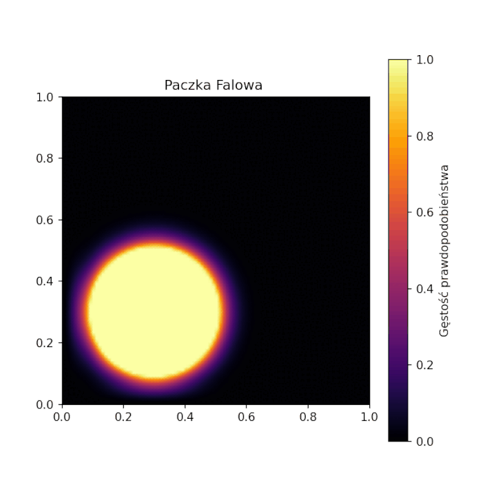

# 2D Quantum Wave Packet Simulation in an Infinite Potential Well

Numerical simulation and visualization of the time-dependent Schrödinger equation for a 2D Gaussian wave packet inside an infinite square potential well.

---

## Animation Preview



---

## Overview

The project simulates the time evolution of a quantum mechanical wave packet confined within a two-dimensional infinite potential barrier.

The time-dependent wave function $\Psi(x, y, t)$ is modeled using eigenstate expansion into the spatial stationary states of the 2D infinite well:

$$\Psi(x, y, t) = \sum_{n_x, n_y} c_{n_x, n_y} \phi_{n_x}(x) \phi_{n_y}(y) e^{-i E_{n_x, n_y} t / \hbar}$$

### Key Features
- **Eigenstate Expansion:** Calculation of projection coefficients (overlap integrals) for stationary states.
- **Probability Density Mapping:** Time-resolved computation of $\vert{}\Psi(x, y, t)\vert{}^2$.
- **Boundary Reflections:** Visualization of wave packet dispersion, quantum interference patterns, and boundary collisions.
- **Dynamic Visualization:** Rendering using `matplotlib.animation.FuncAnimation`.

---

## Setup and Usage

### Prerequisites
- Python 3.9+
- Jupyter Notebook / VS Code

### Installation
Clone the repository:
```bash
git clone [https://github.com/FranekJak/quantum-wavepacket-2d.git](https://github.com/FranekJak/quantum-wavepacket-2d.git)
cd quantum-wavepacket-2d
